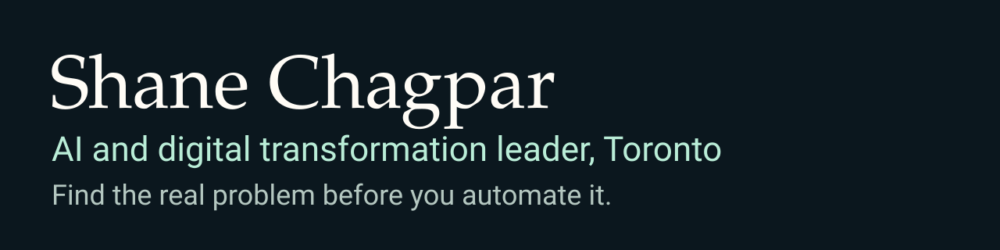

<!--
  SHANE CHAGPAR - GITHUB PROFILE
  This README is meant for the public repository MajorIncident/MajorIncident.
  It uses one self-hosted visual (banner.svg) plus optional static Shields badges.
-->

  

  
  &nbsp;
  
  &nbsp;
  

### Hi, I'm Shane.

I lead **Digital Solutions & Diagnostics at [Kepner-Tregoe](https://kepner-tregoe.com/)**, where I work at the intersection of **AI-enabled transformation, digital product development, and structured problem solving**.

My work connects strategy to execution: finding the real problem, designing something people want to use, and building the systems to make it work in practice. I'm equally at home leading an enterprise transformation, mapping a complex incident, or getting into the code.

> **The thread that connects it all:** better systems should make it easier for people to think clearly, act confidently, and deliver meaningful results.

---

### Selected work

**[01 / Incident Mapping](https://github.com/MajorIncident/incidentmapping)**  
A visual, evidence-first workspace for building an incident's causal story: events, contributing factors, controls, actions, and supporting evidence. Designed to keep chronology and causality distinct.

**[02 / KT Intake](https://github.com/MajorIncident/Intake)**  
A browser-first incident-analysis workspace for structured facilitation, AI-assisted summaries, resilient local saves, and optional collaboration.

**[03 / KT ServiceNow Applications](https://github.com/MajorIncident/KT-ServiceNow)**  
Enterprise applications supporting incident management, problem management, and case analysis through more structured diagnosis and resolution.

**[04 / Sucré Digital Studio](https://sucre.to/)**  
A real-world product lab hidden inside a Toronto custom-cake atelier. I use AI-assisted intake, workflow automation, pricing logic, and digital experience design to connect craftsmanship with thoughtful technology. *The studio's production systems are private.*

---

### What I work on

- **Intelligent workflows:** useful AI, agent-assisted processes, human oversight, and pragmatic automation.
- **Product and experience design:** turning complicated requirements into approachable, intuitive tools.
- **Operational problem solving:** incident analysis, root-cause reasoning, decision support, and service reliability.
- **Engineering that holds up:** testing, documentation, safe releases, and maintainable systems.

**Tools I reach for**

  
  
  
  
  
  
  
  
  
  

---

### Sharing what I learn

I also teach and speak about making complex technology challenges easier to understand. Some of that work is available through **LinkedIn Learning**:

- [IT Service Management Foundations: Problem Management](https://www.linkedin.com/learning/it-service-management-foundations-problem-management)
- [ServiceNow: Basic Administration](https://www.linkedin.com/learning/servicenow-basic-administration-25085067)

My background spans enterprise IT, service management, transformation, product leadership, and hands-on engineering. I've also been fortunate to receive **two national Best Speaker awards** at itSMF Australia's 2018 and 2019 conferences.

### Beyond the keyboard

I care about the experience behind the system. That extends all the way from enterprise products to the cake studio I co-run, where small details, demanding constraints, and good design really do matter.

  Based in Toronto, Canada &nbsp; | &nbsp; <a href="https://www.linkedin.com/in/shanechagpar/">Connect on LinkedIn</a> &nbsp; | &nbsp; <a href="https://github.com/MajorIncident?tab=repositories">Explore my repositories</a>

